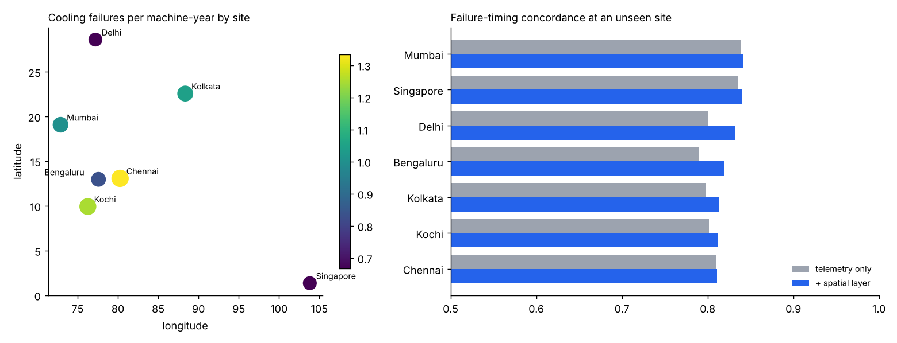

# Imaging Predictive Maintenance

Forecasts **when** a CT or MRI scanner is likely to fail and **which component** will cause it, from operational and environmental telemetry, with a spatial layer that transfers failure risk between hospital sites.

> **Context.** As a Vos Family Global Research Scholar (2025), I studied CT and MRI workflows on site at seven hospitals in India and Singapore and designed a predictive-maintenance pipeline that combines machine learning with a spatial data model. The hospital data from that study is not public. This repository is an independent implementation of the approach on a **synthetic fleet**: 56 scanners across seven cities over three years. Site coordinates are approximate city locations, and no real hospital or device data is included.



## The problem

Unplanned downtime on a CT or MRI scanner cancels scans and delays diagnoses. Failures have precursors (rising tube arcing, coolant temperature drift, power supply ripple, helium boil-off), but these signals are noisy, and some drivers never show up in any sensor at all. Coastal salt air and dust, for example, clog chiller filters and contaminate coil contacts. A single site rarely has enough failure history to learn that on its own, but nearby sites share the same environment.

## Approach

| Component | Module | Details |
|---|---|---|
| Fleet simulator | `fleet.py` | Daily telemetry per machine. Hidden component wear drives five failure modes (X-ray tube, cooling, power supply, cryogen, RF/gradient coil). An unobserved, spatially smooth environmental field raises cooling and coil hazard. |
| Labels | `features.py` | Days until the next failure, right-censored at the end of each record, plus the mode of that failure. |
| Telemetry features | `features.py` | 7- and 30-day rolling means and short-versus-long trends for every sensor, service recency, machine age, and modality. |
| Spatial layer | `features.py` | Inverse-distance-weighted failure rates, by mode, from **other** sites (haversine distance). The site itself is always excluded, so the feature carries only what the neighborhood implies, which is exactly what is known about a newly onboarded hospital. |
| Failure timing | `model.py` | XGBoost accelerated failure time (AFT) survival model that uses censored observations correctly instead of discarding them. |
| Root cause | `model.py` | Multiclass XGBoost trained on the 14 days before each observed failure. |

## Results

Evaluation is **leave-one-site-out**: train on six sites and test on the seventh, for every site. This answers the deployment question that matters, which is how well the model works at a hospital it has never seen.

`python -m imaging_pdm evaluate`

| | Telemetry only | + Spatial layer |
|---|---|---|
| Failure-timing concordance (C-index) | 0.811 | **0.824** |
| Alert precision, riskiest 5% of machine-days | 41.3% | **46.9%** |
| Alert recall, failures within 14 days | 24.6% | **27.6%** |
| Alert lift over base rate | 4.9x | **5.5x** |
| Root-cause accuracy | 81.7% | **83.1%** |
| Root-cause macro F1 | 0.784 | **0.795** |

The spatial layer improves timing concordance at every one of the seven held-out sites. The largest recall gains are in Chennai and Delhi, where neighboring sites carry information the local telemetry does not.

### Maintenance work list

`python -m imaging_pdm alerts` trains on the full fleet and ranks every machine for the latest day so engineers can intervene before downtime:

```
machine_id      site modality  predicted_days_to_failure likely_root_cause  days_since_service
      M032 Bengaluru      MRI                        8.0  rf_gradient_coil                   4
      M043     Kochi       CT                       12.0         xray_tube                  69
      M053 Singapore       CT                       15.0      power_supply                  25
      M025 Bengaluru       CT                       15.0           cooling                  13
      M034   Kolkata      MRI                       16.0           cryogen                  79
```

## Quick start

```bash
pip install -r requirements.txt
python -m imaging_pdm evaluate        # leave-one-site-out comparison, writes docs/results.png
python -m imaging_pdm alerts --top 10
pytest
```

## Limitations

- The fleet is simulated. The simulator encodes plausible mechanisms, so these results show that the pipeline recovers them, not how it would perform on a specific real fleet.
- With seven sites, the spatial layer has few neighbors to learn from. Its value should grow with the number of sites, and a real deployment would replace inverse-distance weighting with a fitted spatial model (for example, a Gaussian process over site locations).
- Neighboring sites' rates are computed over their full history. A production system would restrict them to data available at prediction time.

## Project layout

```
imaging_pdm/
  fleet.py      synthetic CT/MRI telemetry and failure simulator
  features.py   labels, rolling features, spatial layer
  model.py      AFT survival model, root-cause classifier, leave-one-site-out evaluation
  cli.py        evaluate / alerts
tests/          pytest suite
```

## License

MIT
